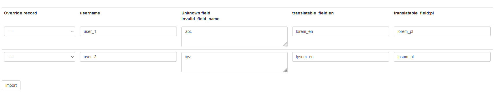

# BatchEntityImportBundle


[](https://insight.symfony.com/projects/ad63558e-3612-434f-a93d-0fc5fce2dd20)

Importing entities with preview and edit features for Symfony.

* Data can be **viewed and edited** before saving to database.
* Supports **inserting** new records and **updating** existing ones.
* Supported extensions: **CSV, XLS, XLSX, ODS**.
* Supports translations from **KnpLabs Translatable** extension.
* The code is divided into smaller methods that can be easily replaced if you want to change something.
* Columns names are required and should be added as header (first row).
* If column does not have name provided, will be removed from loaded data.




## Installation

Install package via composer:

```
composer require jgrygierek/batch-entity-import-bundle
```

Add entry to `bundles.php` file:

```
JG\BatchEntityImportBundle\BatchEntityImportBundle::class => ['all' => true],
```

## Documentation

* [Configuration class](docs/configuration.md) - entity to import, types of fields, validation, allowed file extensions.
* [Controller](docs/controller.md) - controller with import actions, events dispatched after import.
* [Import files](docs/files.md) - rules for header and rows, CSV delimiter and encoding, size limit, translatable columns, full example of file.
* [Overriding templates](docs/templates.md) - global and controller-specific templates, main layout, additional data.
* [Updating entities](docs/updating-entities.md) - updating existing records instead of inserting new ones.
* [Importing data to array field](docs/array-fields.md) - values with separator imported as array.
* [Importing relations](docs/relations.md) - `ManyToOne` and `OneToOne` relations imported by value of any field.
* [Upgrade notes](UPGRADE.md) - changes between versions.
