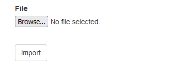

# BatchEntityImportBundle


[](https://insight.symfony.com/projects/ad63558e-3612-434f-a93d-0fc5fce2dd20)

Importing entities with preview and edit features for Symfony.

* Data can be **viewed and edited** before saving to database.
* Supports **inserting** new records and **updating** existing ones.
* Supported extensions: **CSV, XLS, XLSX, ODS**.
* Supports translations from **KnpLabs Translatable** extension.
* Import can be adjusted in configuration class (fields, validation, allowed columns, creating entities) and in controller (templates, views).
* Columns names are required and should be added as header (first row).
* If column does not have name provided, will be removed from loaded data.




## Versions

| Version | Status | Last release | PHP | Symfony | Documentation |
|---|---|---|---|---|---|
| **4.x** | Actively developed | - | >= 8.4 | 7.4, 8.* | [master](docs) |
| **3.x** | Not maintained | 3.14.0 | >= 8.3 | 6.4, 7.*, 8.* | [v3.14.0](https://github.com/jgrygierek/BatchEntityImportBundle/tree/v3.14.0/docs) |
| **2.x** | Not maintained | 2.6.0 | >= 7.4 | 4.4, 5.*, 6.* | [v2.6.0](https://github.com/jgrygierek/BatchEntityImportBundle/tree/v2.6.0#readme) |
| **1.x** | Not maintained | 1.1.5 | >= 7.4 | 4.4, 5.* | [v1.1.5](https://github.com/jgrygierek/BatchEntityImportBundle/tree/v1.1.5#readme) |

Requirements of PHP and Symfony are given for the last release of each version.

Changes between versions and steps needed to upgrade are described in [UPGRADE.md](UPGRADE.md).

## Installation

Install package via composer:

```
composer require jgrygierek/batch-entity-import-bundle
```

If your project can't be upgraded to requirements of version 4 yet, install version 3:

```
composer require jgrygierek/batch-entity-import-bundle:^3.14
```

If your application uses Symfony Flex, bundle is registered automatically. Otherwise add entry to `config/bundles.php` file:

```
JG\BatchEntityImportBundle\BatchEntityImportBundle::class => ['all' => true],
```

## Documentation

* [Configuration class](docs/configuration.md) - entity to import, types of fields, validation, allowed columns and file extensions.
* [Controller](docs/controller.md) - controller with import actions, events dispatched after import.
* [Import files](docs/files.md) - rules for header and rows, CSV delimiter and encoding, size limit, translatable columns, full example of file.
* [Overriding templates](docs/templates.md) - global and controller-specific templates, main layout, additional data.
* [Updating entities](docs/updating-entities.md) - updating existing records instead of inserting new ones.
* [Importing data to array field](docs/array-fields.md) - values with separator imported as array.
* [Importing relations](docs/relations.md) - `ManyToOne` and `OneToOne` relations imported by value of any field.
* [Upgrade notes](UPGRADE.md) - changes between versions.
